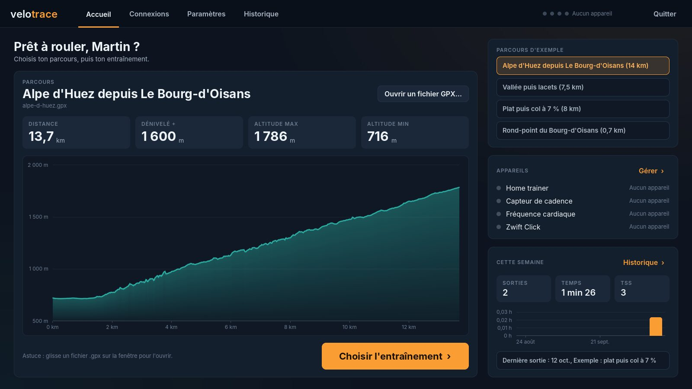
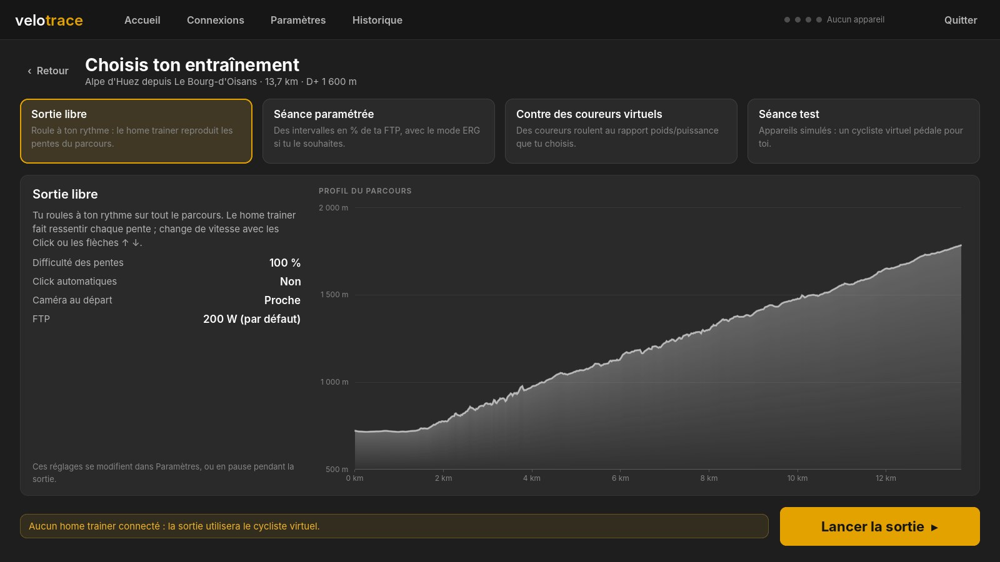
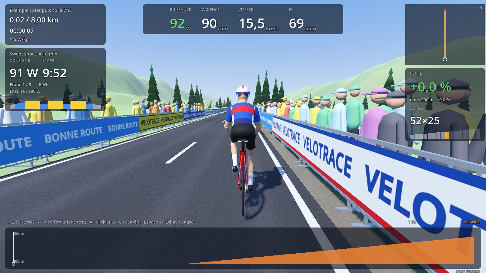
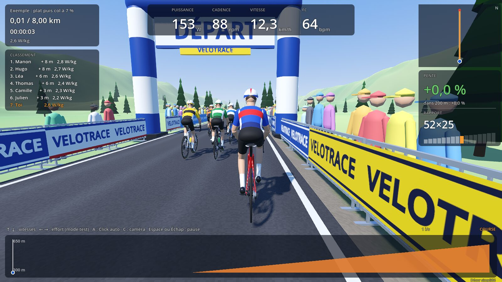
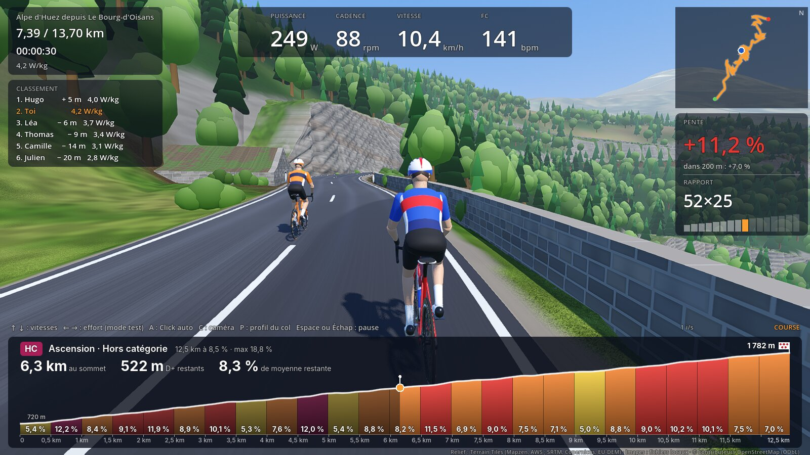
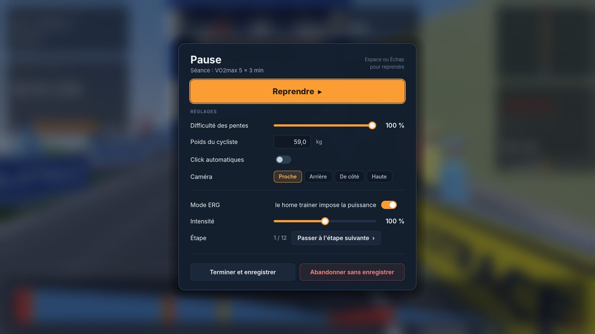
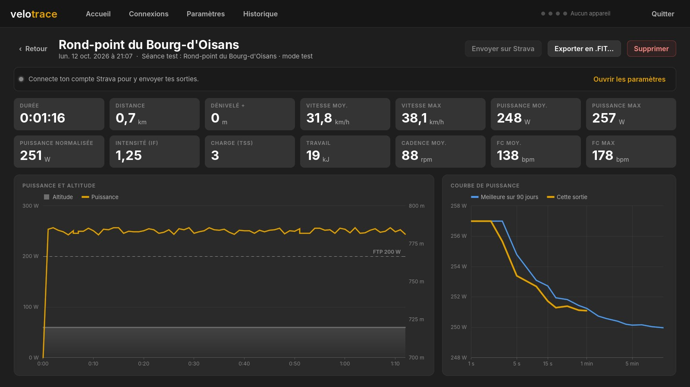
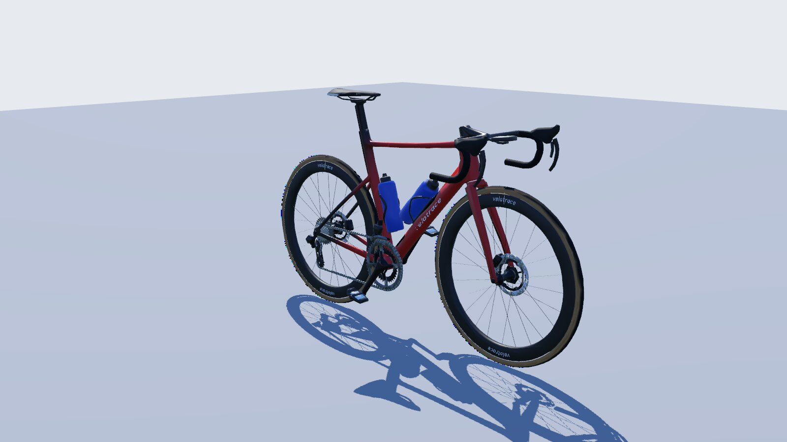

# velotrace

Application de home trainer pour Windows et Linux, dans l'esprit de Zwift et MyWhoosh : on importe un GPX, l'application génère le monde 3D autour de la trace, et on la parcourt avec les vrais rapports et les vraies pentes de son vélo.

Architecture et plan : [docs/architecture.md](docs/architecture.md).

## État

Étape 1 en cours : le cœur `velo-core` (Rust) contient

- le profil cycliste, vélo et home trainer, sauvegardé en TOML ;
- la transmission et le changement de vitesse virtuel (Zwift Click) ;
- le modèle physique et le calcul de la pente envoyée au home trainer ;
- la lecture d'un GPX, le rééchantillonnage et le lissage des pentes ;
- l'encodage et le décodage des trames BLE FTMS, CSC et HRS ;
- le **mode test**, qui simule le home trainer, le capteur de cadence, la FC et les Zwift Click ;
- les séances (mode ERG, import `.zwo`), les coureurs virtuels, l'enregistrement à 1 Hz, le bilan (NP, IF, TSS), la courbe de puissance et l'export `.FIT`.

Autour de lui :

- `velo-world` construit le décor réel (relief, images aériennes, OpenStreetMap) ;
- `velo-ble` pilote le vrai matériel en Bluetooth (home trainer FTMS, cadence, FC, Zwift Click) ;
- `velo-store` garde l'historique des sorties dans une base SQLite locale (courbes de puissance, volume, forme) ;
- `velo-strava` relie le compte Strava (OAuth) et y envoie les sorties ;
- `velo-godot` expose le tout à l'application Godot (`app/`).

## L'application (Godot)

Il faut [Godot 4.5 ou plus récent](https://godotengine.org/download) et Rust 1.94 ou plus récent (`rustup update stable`).

```sh
cargo build -p velo-godot          # compile l'extension Rust chargée par Godot
godot --path app                   # ou ouvrir app/project.godot dans l'éditeur Godot et appuyer sur F5
```



**Accueil** : choisis un parcours d'exemple, ouvre ton GPX ou glisse-le sur la fenêtre ; le profil, la distance et le dénivelé s'affichent, avec l'état des appareils et ta semaine. Le dernier parcours est repris au lancement suivant.

**Connexions** : recherche Bluetooth, puis « Connecter » pour chaque rôle (home trainer FTMS, capteur de cadence, fréquence cardiaque, Zwift Click, deux Click possibles). Chaque carte affiche la mesure en direct (W et rpm, bpm, appui sur un Click), la batterie et l'état du lien ; les appareils sont retenus et reconnectés au lancement suivant. L'interrupteur **Mode test** remplace tout le matériel par des appareils simulés.

**Paramètres** : cycliste (poids, FTP et zones), vélo (plateaux, cassette, roue, CdA, Crr, rendement), home trainer (rapport physique, difficulté des pentes, pentes limites), affichage et décor (caméra, décor, qualité, Click automatiques) et Strava. Tout est enregistré dans `~/.config/velotrace/profile.toml` (`%APPDATA%\velotrace\profile.toml` sous Windows).



**Entraînement**, quatre modes :

- **Sortie libre** : le home trainer reproduit les pentes, tu changes de vitesse aux Click ;
- **Séance paramétrée** : six séances prêtes (endurance, sweet spot, seuil, VO2max, pyramide, test FTP), import d'un fichier Zwift `.zwo` ou séance composée étape par étape, en % de FTP ; en mode ERG le home trainer impose la puissance, sinon la consigne s'affiche seulement ; intensité réglable de 50 à 150 % ;
- **Contre des coureurs virtuels** : 1 à 8 coureurs au rapport poids/puissance choisi (avec un écart entre eux), qui appuient un peu plus en montée, roulent en roue libre dans les descentes raides et profitent de l'aspiration ; classement en direct ;
- **Séance test** : le cycliste virtuel du mode test (cadence imposée et Click automatiques, ou puissance imposée).

Sans home trainer connecté, les trois premiers modes roulent aussi avec le cycliste virtuel.







**Mode col** : 100 m avant le pied de chaque ascension, le profil du bas laisse la place à celui du col seul, comme sur MyWhoosh : tronçons de 250 ou 500 m colorés selon leur pente (écrite dessus), kilomètres, drapeau à pois au sommet avec son altitude, ta position et celle des coureurs virtuels, et en tête la catégorie (4e à hors catégorie), la distance au sommet, le dénivelé restant et la pente moyenne de ce qui reste. Un bandeau annonce le début de l'ascension (longueur, pente, catégorie), un autre le sommet avec le temps de montée ; 100 m après le sommet, le profil du parcours revient. P bascule à tout moment entre le profil du parcours et celui du col en cours ou du prochain.

Pendant la sortie : ↑ et ↓ changent de vitesse (Click), ← et → règlent l'effort du cycliste virtuel, A active ou coupe les Click automatiques, C change de caméra, P affiche le profil du col ou du parcours, Espace ou Échap met en **pause**. En pause, on ajuste la difficulté des pentes, le poids, les Click automatiques, la caméra, et selon le mode l'ERG, l'intensité et l'étape de la séance, le niveau des coureurs virtuels ou l'effort du cycliste virtuel ; puis on reprend, on termine (la sortie est enregistrée) ou on abandonne sans enregistrer.





**Fin de sortie** : la sortie est enregistrée à 1 Hz (position, altitude, vitesse, puissance, cadence, FC) dans une base SQLite locale (`~/.local/share/velotrace/velotrace.db`, `%APPDATA%\velotrace` sous Windows). Le bilan donne durée, distance, dénivelé, vitesses, puissances moyenne, maximale et normalisée, IF, TSS, travail, cadence et FC, la courbe de puissance de la sortie face à ta meilleure sur 90 jours, et propose l'**export .FIT** (Strava, Garmin Connect, Coros, Intervals.icu) et l'**envoi sur Strava**.

**Historique** : liste des sorties, courbe de puissance record (tout, 365, 90 et 42 jours) avec FTP estimée, volume par semaine (heures, TSS), forme (CTL, ATL, TSB) et records.

**Strava** : crée une application API gratuite sur [strava.com/settings/api](https://www.strava.com/settings/api) avec `localhost` comme domaine de rappel, colle son client ID et son secret dans Paramètres › Strava, puis « Se connecter à Strava » : l'autorisation se fait dans le navigateur, une fois. Les sorties partent ensuite d'un clic dans le bilan, ou automatiquement si tu le demandes.


Le cycliste, un corps humain complet, sec et musclé, tiré des modèles libres (CC0) de MakeHuman, roule sur un vélo de route détaillé (cadre à tube incliné, cintre route, transmission, roues carbone à rayons, pneus à flancs beiges). Un squelette l'anime : bassin basculé, dos arrondi, épaules, coudes, poignets et chevilles suivent le vélo et les doigts se referment sur le cintre. Il porte un maillot aux couleurs de son équipe (flancs, bande de poitrine, manches à liseré), un cuissard noir, des mitaines, des chaussettes blanches, des chaussures à molette et cales, un casque ventilé et des lunettes à verres miroir ; le maillage est reconstruit par `tools/rider/build_rider.py` (voir `app/assets/rider/LICENSE.md`). Sa position suit l'effort : pied à terre à l'arrêt, assis les mains aux cocottes, en position aéro les mains en bas du cintre sur le plat et en descente quand la puissance est élevée, en danseuse en sprint et dans les montées appuyées, le vélo balancé au rythme du pédalage. La caméra par défaut le suit de près, juste derrière, et glisse vers l'extérieur dans les virages pour le montrer un peu de côté ; C passe ensuite aux caméras arrière, de côté et haute.



Le vélo est un aéro moderne modelé par champs de distance (`app/scripts/bike.gd`, mailleur Rust `velo_world::sdf`) : cadre carbone aux tubes profilés raccordés par des congés, douille conique, haubans abaissés, tige de selle intégrée, cockpit monobloc avec compteur, cocottes et guidoline, roues de 50 mm à rayons plats, freins à disque, transmission 2×12 dentée avec chaîne animée et dérailleurs, selle à rails, deux bidons. Peinture à paillettes et vernis, fibre de carbone visible, inscriptions « velotrace » ; la couleur du cadre et des bidons suit l'équipe. Les maillages (environ 80 000 triangles, 38 000 et 25 000 aux niveaux de détail suivants) sont construits une fois puis gardés dans le dossier utilisateur.

Pour démarrer directement sur un parcours, sans le menu : `godot --path app -- --gpx /chemin/vers/sortie.gpx [--puissance 220] [--mode libre|seance|adversaires|test] [--seance 2] [--adversaires 5 --wkg 3.2]`.

### Décor réel


Au menu, **Décor réel** télécharge une fois, puis garde en cache (`~/.cache/velotrace` sous Linux, `%LOCALAPPDATA%\velotrace` sous Windows) :

- le **relief** (tuiles « terrarium » sur AWS, ~13 m) ; l'altitude du parcours en est tirée puis lissée, pour des pentes fidèles ;
- les **images aériennes** de l'IGN (BD ORTHO®, France) plaquées sur le sol ; ailleurs ou hors connexion, le sol est coloré d'après l'altitude, la pente et OpenStreetMap ;
- **OpenStreetMap** via Overpass (avec deux serveurs de secours si le premier ne répond pas) : forêts, eau, bâtiments, routes et rivières.


La route suit un tracé lissé, rééchantillonné tous les mètres : enrobé avec grain, rustines, traces de roues et marquages usés, accotements en gravier puis en herbe, buissons sur les bords et balises J6 tous les 50 m. Le relief est aplani sous la chaussée puis rejoint le terrain sur une trentaine de mètres, il ne la coupe plus. Le cycliste tient sa droite en montée et coupe les virages à la corde sur le plat et en descente, en s'inclinant selon la vitesse.


Avec OpenStreetMap, la route devient celle de la réalité : le tracé du GPX est recalé sur la route OSM, la largeur et le nombre de voies viennent des étiquettes `width` et `lanes` (sinon du type de route), avec axe discontinu, continu dans les lacets, et séparations de voies. Les trottoirs viennent de `sidewalk` ; quand OSM ne dit rien, une rue bordée de façades en reçoit un. Les routes qui débouchent sur le parcours partent de leur vrai nœud de jonction, sous la chaussée, avec la même pente qu'elle : amorce de 30 m évasée au carrefour (moins quand elle arrive en biais), ligne « cédez le passage » et rive discontinue sur la route principale ; au-delà, elles continuent drapées sur le relief avec le même enrobé (ou en piste de terre). Une route qui longe le parcours ou le croise sans s'y raccorder (pont, voie parallèle) reste dessinée telle quelle. Les ronds-points (`junction=roundabout`, ou anneaux presque circulaires) gardent leur vraie forme, souvent ovale, et leur pente ; le cycliste y tient sa droite. L'exemple « Rond-point du Bourg-d'Oisans » en traverse un.


Près de la route, l'image aérienne, trop floue de près, laisse place à un sol dessiné : prairie avec ses touffes, ses brins et quelques fleurs, cailloux et éboulis sur les pentes raides, terre et aiguilles en forêt, enrobé, dalles ou pavés autour des maisons. La nature du sol vient de l'occupation OSM, de la pente et de la proximité des bâtiments. L'accotement utilise exactement la même texture, si bien qu'il se fond dans le sol sans couture ; plus loin, le sol dessiné rejoint l'image par une lisière irrégulière.


Là où la montagne est raide au bord de la route, un mur de soutènement en moellons la retient (jusqu'à 4 m, avec une terrasse herbeuse au-dessus) ; au-dessus du vide, un parapet de 75 cm borde la chaussée.


Au-delà de 45°, une falaise sculptée se dresse au bord de la route : paroi en relief jusqu'à 30 m de haut, avec ses bancs inclinés en corniches, ses ravines, ses surplombs, ses coulures, ses lichens et un rebord herbeux qui rejoint la pente.


Comme sur le Tour de France : arche gonflable bleue et blanche au départ, banderole à pois au pied de chaque ascension (longueur, pente moyenne et catégorie, de la 4e à hors catégorie), arche à pois « Grand prix de la montagne » au sommet, banderoles 3 km et 2 km, flamme rouge au dernier kilomètre et, à l'arrivée, un portique en treillis métallique avec son chronomètre, sa banderole « ARRIVÉE » et une ligne peinte à damier. Des barrières habillées de bâches imprimées (slogans inventés, aucune vraie marque) bordent ces endroits, les 300 derniers mètres en entier, avec du public derrière. Une ascension compte à partir de 80 m de dénivelé à 3 % de moyenne.

Près du parcours, des sapins et des feuillus poussent là où OSM indique une forêt ou là où l'image aérienne est vert sombre (version détaillée de près, simplifiée au-delà) ; les bâtiments sont extrudés à leur hauteur avec des fenêtres et restent visibles au loin, les routes et rivières sont drapées sur le relief, les lacs posés à plat. Près de la route, l'herbe des accotements et un grain de détail sur le sol masquent le flou des images aériennes.

**Qualité** basse, moyenne ou haute : distance du décor, finesse des images (2 m, 1 m ou 0,5 m par pixel), densité et portée des arbres, ombres, anticrénelage et échelle de rendu (FSR). L'affichage est plafonné à 60 images/s. Les carrés de décor détaillés (512 m) sont générés en arrière-plan autour du cycliste et libérés derrière lui ; au loin, des carrés de 2 km peu détaillés. Sur une Intel HD 630, commence en qualité moyenne.

Options en ligne de commande : `--decor reel|cache|simple`, `--qualite 0|1|2`, `--osm-fichier data/osm-alpe-d-huez.json` (OSM depuis un fichier au lieu d'Overpass), `--images <url {z}/{x}/{y}>` (autre source d'images, `file://` accepté), `--aller-a <m>`.

Sans Godot : `cargo run --release -p velo-world --example decor -- data/alpe-d-huez.gpx --osm data/osm-alpe-d-huez.json` construit le décor et affiche ce qui a été trouvé. Ce fichier OSM d'essai vient d'Overture Maps : il a la géométrie des routes OSM mais pas leurs étiquettes de voies, de trottoirs ni de ronds-points, qui y sont donc déduites ; avec Overpass, ce sont les vraies.

## Essayer le cœur en ligne de commande

```sh
cargo test
cargo run -p velo-core --example gears                     # rapports virtuels
cargo run -p velo-core --example simulate -- data/exemple-col.gpx              # mode test, cadence 88 rpm et Click automatiques
cargo run -p velo-core --example simulate -- data/exemple-col.gpx --power 200  # mode test à 200 W
```

## Vérifier son matériel (velo-probe)

Sous Linux, installer d'abord `libdbus-1-dev` et `pkg-config` (`sudo apt install libdbus-1-dev pkg-config`), puis, près du vélo :

```sh
cargo run --release -p velo-probe -- scan       # appareils Bluetooth à portée
cargo run --release -p velo-probe -- trainer    # données du home trainer, puis pentes de 0 %, 2 % et 8 %
cargo run --release -p velo-probe -- capteurs   # cadence et fréquence cardiaque
cargo run --release -p velo-probe -- click      # boutons des Zwift Click
```

Fermer Zwift, MyWhoosh ou l'appli Decathlon avant : un home trainer n'accepte souvent qu'une seule connexion Bluetooth. Le Click gauche V2 peut exiger un déverrouillage quotidien (se connecter une fois à l'appli Zwift avec le Click, puis la fermer) ; le Click droit fonctionne sans.
